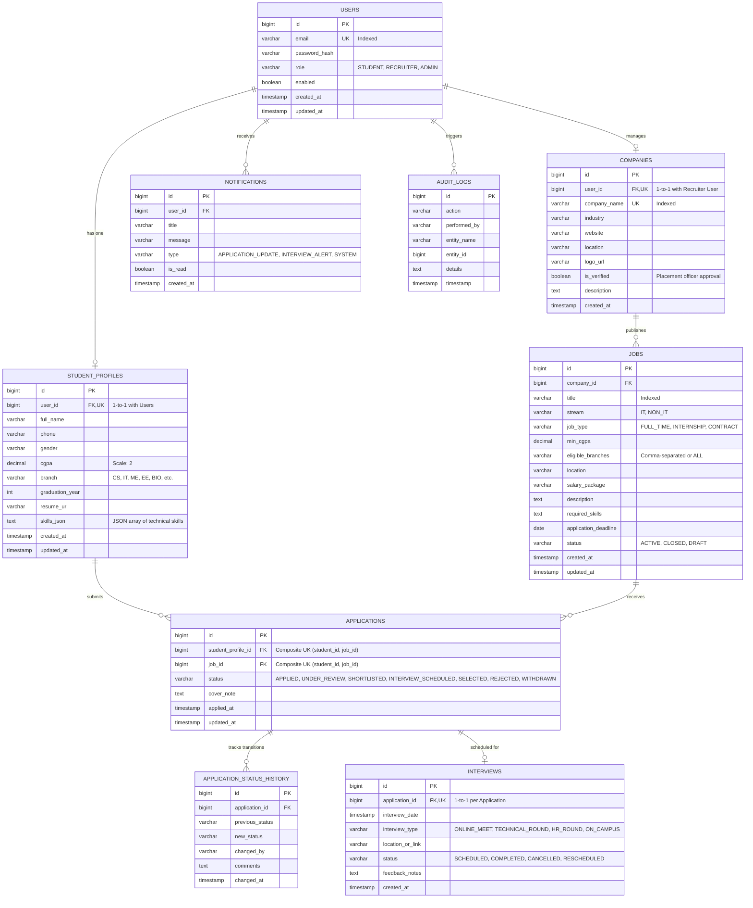

# Database Schema Design: Campus Placement Assistance

## 1. Entity Relationship (ER) Diagram

---

## 2. Table-by-Table Specifications & Indexing Strategy

### 1. `users`
- **Primary Key:** `id` (AUTO_INCREMENT, BIGINT)
- **Unique Constraints:** `email` (Case-insensitive unique index `idx_users_email`)
- **Indexes:** `idx_users_role` on `(role)` for rapid role-based filtering.

### 2. `student_profiles`
- **Foreign Key:** `user_id` → `users(id)` ON DELETE CASCADE
- **Indexes:** 
  - `idx_student_branch_cgpa` on `(branch, cgpa)` to power backend eligibility queries.
  - `idx_student_grad_year` on `(graduation_year)`.

### 3. `companies`
- **Foreign Key:** `user_id` → `users(id)` ON DELETE SET NULL
- **Indexes:** `idx_company_verified` on `(is_verified)` for placement officer moderation workflows.

### 4. `jobs`
- **Foreign Key:** `company_id` → `companies(id)` ON DELETE CASCADE
- **Indexes:**
  - `idx_jobs_stream_status` on `(stream, status)` for fast student catalog filtering (IT vs Non-IT).
  - `idx_jobs_deadline` on `(application_deadline)` for automated expiration jobs.

### 5. `applications`
- **Foreign Keys:**
  - `student_profile_id` → `student_profiles(id)` ON DELETE CASCADE
  - `job_id` → `jobs(id)` ON DELETE CASCADE
- **Unique Constraint:** `uk_student_job` on `(student_profile_id, job_id)` prevents duplicate submissions at the database engine level.
- **Indexes:** `idx_applications_status` on `(status)`.

### 6. `application_status_history`
- **Foreign Key:** `application_id` → `applications(id)` ON DELETE CASCADE
- **Purpose:** Full immutable audit trail of candidate recruitment stages.

### 7. `interviews`
- **Foreign Key:** `application_id` → `applications(id)` ON DELETE CASCADE
- **Indexes:** `idx_interview_date` on `(interview_date)` for chronological timeline sorting.
