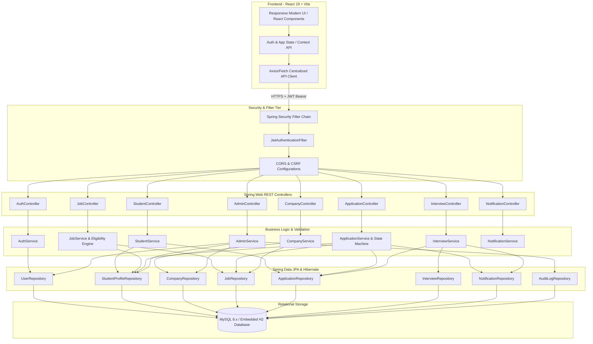
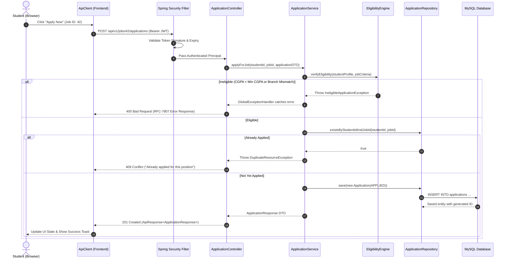

# System Architecture: Campus Placement Assistance

## 1. Architectural Overview

**Campus Placement Assistance** is built as a clean, high-performance, layered **Modular Monolith** designed for enterprise recruitment workflows. The system separates concerns between a modern reactive client frontend and a robust, secure Spring Boot backend.

---

## 2. Layer Responsibilities

### 1. Presentation Tier (REST Controllers)
- **Role:** Exposes versioned REST API endpoints (`/api/v1/...`).
- **Rules:**
  - Controllers contain zero business logic.
  - Accept and validate Request DTOs using `@Valid`.
  - Delegate execution immediately to appropriate Service interfaces.
  - Return strongly-typed `ResponseEntity<ApiResponse<T>>`.

### 2. Service Tier (Business Logic & Transactions)
- **Role:** Enforces all core business rules, transactional boundaries, eligibility logic, and state transitions.
- **Key Capabilities:**
  - **Eligibility Verification:** Evaluates candidate CGPA, graduating year, branch, and active application limits before permitting job application.
  - **Duplicate Prevention:** Verifies whether a student has an existing active application for a target position.
  - **Recruitment State Machine:** Validates allowed status transitions (`APPLIED` → `UNDER_REVIEW` → `SHORTLISTED` → `INTERVIEW_SCHEDULED` → `SELECTED`/`REJECTED`).
  - **Auditing & Notifications:** Emits asynchronous notifications and audit log records upon state modifications.

### 3. Persistence Tier (Entities & Repositories)
- **Role:** Handles object-relational mapping (ORM) with Hibernate and JPA.
- **Features:**
  - Primary/foreign key constraints with referential integrity.
  - Custom JPQL queries with index utilization.
  - Pagination, sorting, and dynamic specification queries.

### 4. Security Tier
- **Role:** Stateless authentication via signed JSON Web Tokens (JWT).
- **Features:**
  - BCrypt password hashing (strength 12).
  - Role-Based Access Control (`ROLE_STUDENT`, `ROLE_RECRUITER`, `ROLE_ADMIN`).
  - Method-level security with `@PreAuthorize`.

---

## 3. Request-Response Lifecycle Flow

